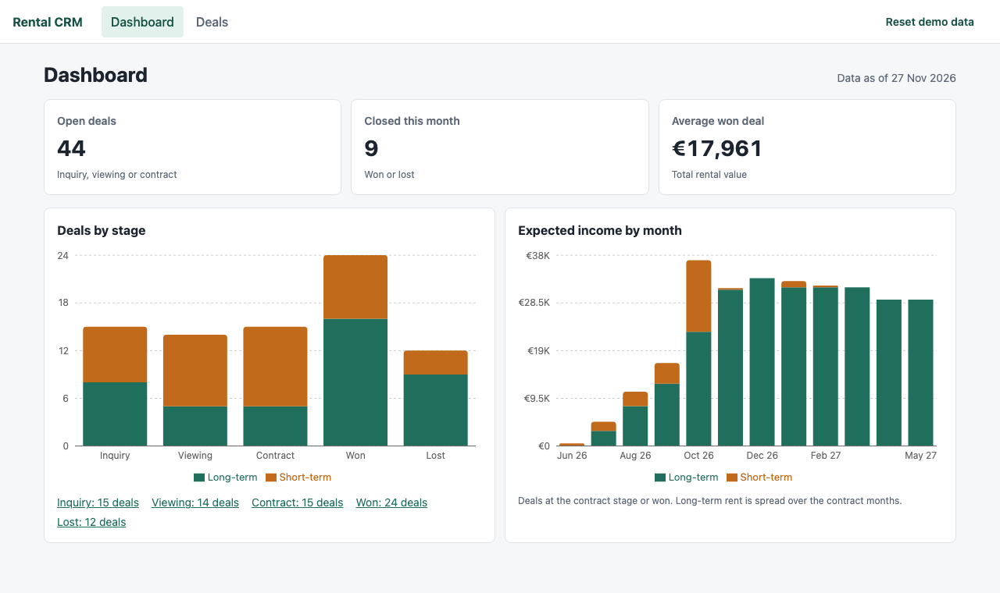
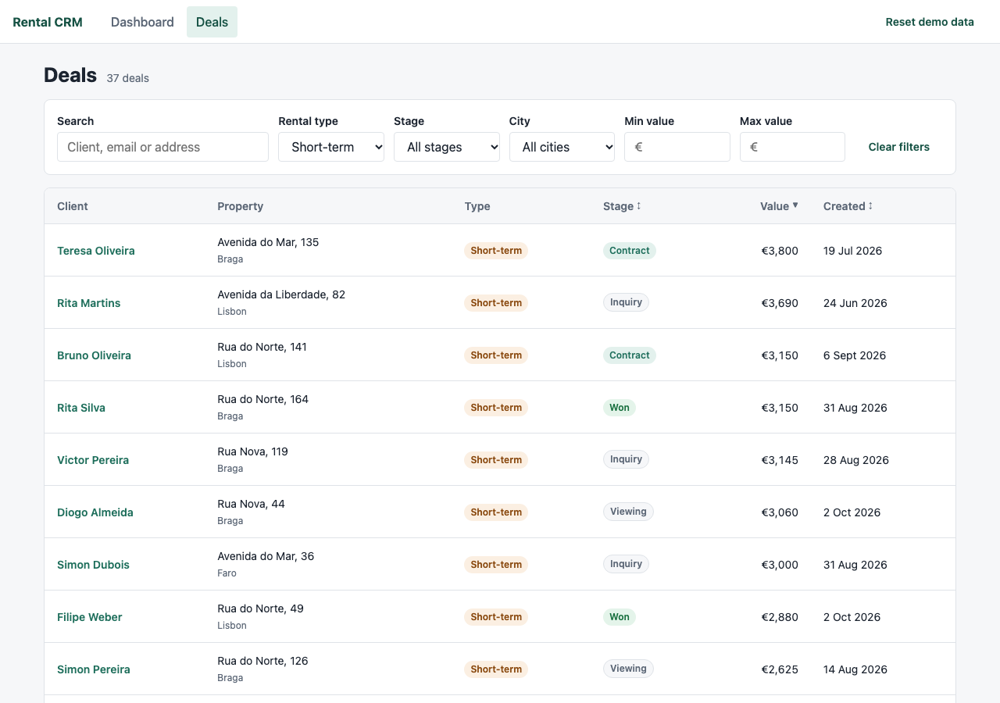
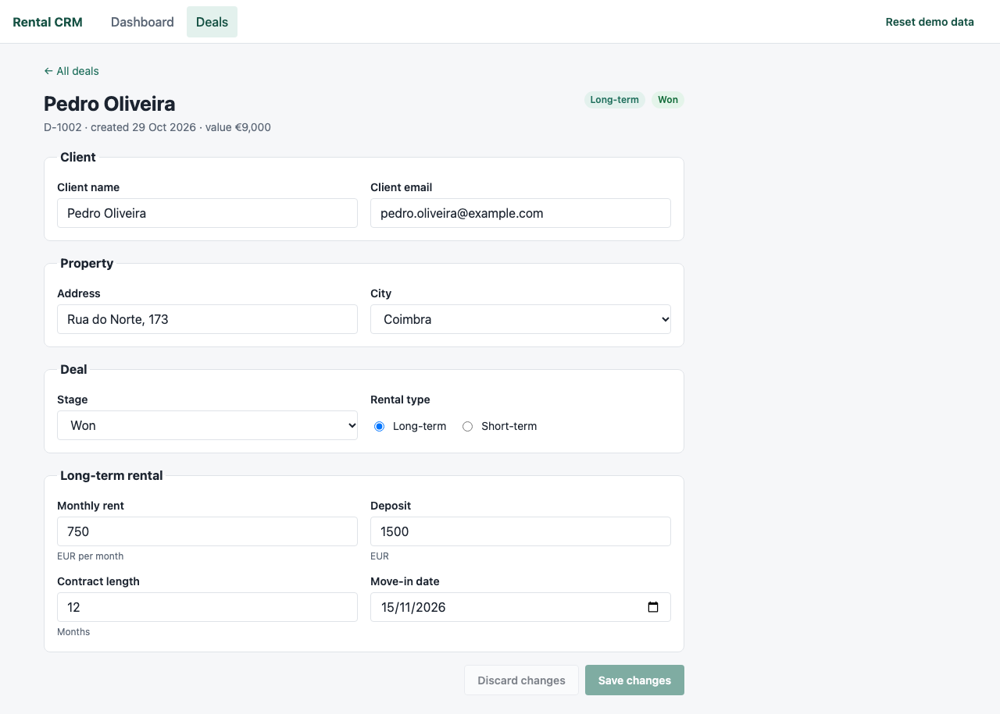

# Rental CRM

A small CRM for a fictional agency that rents out apartments, long-term and short-term.
Built as a portfolio project to show how I structure a React and TypeScript app around
type-safe routing and server-state caching.

**Live demo:** https://mariemanelis.github.io/rental-crm/

All data is invented and lives in your browser. Use **Reset demo data** in the header to
start over.



| Deal list | Deal page |
| --- | --- |
|  |  |

## What it does

- **Deal list** with search, filters (rental type, stage, city, value range), sorting and
  paging. Every filter lives in the URL, so a reload or a shared link shows the same view.
- **Deal page** with an edit form whose fields change with the rental type, cross-field
  validation (check-out after check-in), and a prompt before leaving with unsaved changes.
- **Dashboard** with pipeline and income charts. Clicking a stage opens the list filtered
  by that stage.
- **Error, empty and not-found states**, a demo failure mode, and a working layout from
  375 px phones to desktop.

## Stack and why

| Library | Why it is here |
| --- | --- |
| React 19 + TypeScript (strict) | UI and types for every module boundary |
| TanStack Router | File-based, type-safe routes; search params validated with Zod; route loaders |
| TanStack Query | Server-state cache shared by loaders and components; invalidation after edits |
| Zod | One schema for stored data, form validation and URL search params; types are inferred |
| React Hook Form | Form state, dirty tracking and the Zod resolver |
| Recharts | Dashboard charts, loaded only on the dashboard route |
| CSS Modules | Scoped styles with design tokens in CSS custom properties |
| Playwright | End-to-end tests on desktop and a 375 px mobile viewport |
| Vite | Dev server and build |

## How it works

**The URL and the query cache are the only sources of truth.** There is no global client
store.

- List filters are search params. The route validates them with a Zod schema; an invalid
  value (for example `?page=0`) falls back to its default instead of breaking the page.
  Default values are stripped from the URL.
- Each route loader calls `queryClient.ensureQueryData(...)`, and the component reads the
  same query with `useSuspenseQuery(...)`, so data is in the cache before the screen renders.
- Saving a deal writes the result into the detail cache and invalidates the `['deals']`
  root key, which refreshes the list and the dashboard.
- The "backend" is a small module with artificial latency that filters, sorts and pages
  like a real API and keeps data in `localStorage`. Every value it returns is parsed with
  the `Deal` schema, so corrupted storage shows an error screen with a reset option.
- The app has a fixed "today" (27 Nov 2026), so the seed data and "closed this month" stay
  meaningful after the demo is published.

```
src/
  routes/        URL contract: search schemas, loaders, error and not-found handling
  features/      screens: deals (list, filters, form), dashboard (charts), demo reset
  domain/        Zod schemas, inferred types, pure aggregate functions
  api/           fake API, seed generator, storage
  ui/            small shared components and formatting
e2e/             Playwright specs
```

## Try the failure mode

Add `?demo-fail` to any URL, for example
[`/deals?demo-fail`](https://mariemanelis.github.io/rental-crm/deals?demo-fail). Every request
then fails, and you can see the error screen, the retry button and how a failed save keeps
your edits.

## Run locally

Requires Node.js 22.12 or newer.

```sh
npm install
npm run dev          # http://localhost:5173/rental-crm/
npm run e2e          # builds, then runs Playwright on desktop and mobile
npm run lint
npm run typecheck
```

The first `npm run e2e` needs a browser: `npx playwright install chromium`.

## How it was built

The project followed a spec-first workflow with AI assistance (Claude Code): requirements,
technical design and a task list were written and reviewed before any code, and every task
was closed with evidence (a test run or a checked screenshot).

- [Product requirements](tasks/rental-crm-demo/2026-11-27-rental-crm-demo-prd.md)
- [Technical design](tasks/rental-crm-demo/2026-11-27-rental-crm-demo-tech-design.md)
- [Task list with evidence](tasks/rental-crm-demo/2026-11-27-rental-crm-demo-tasks.md)
